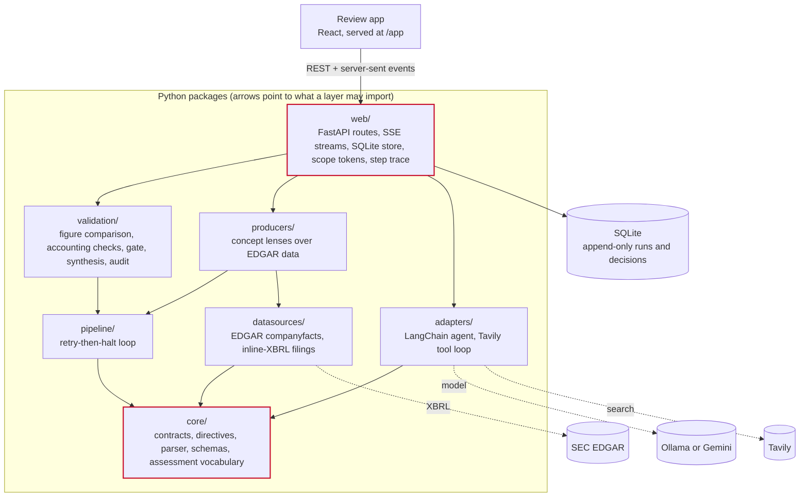
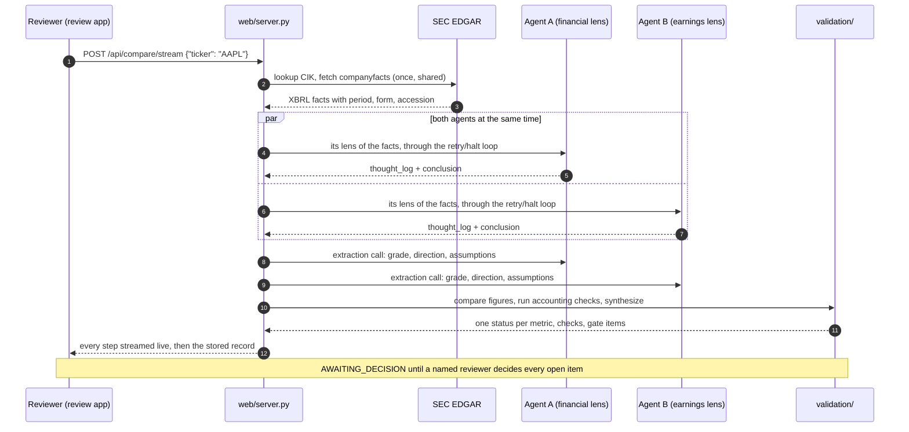
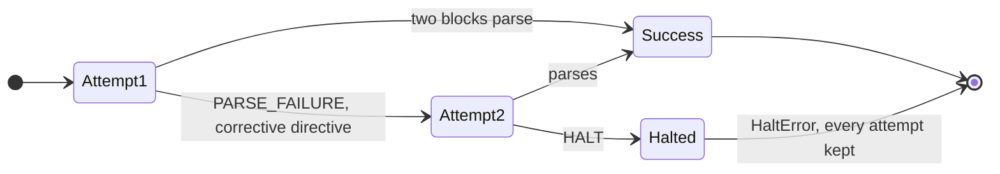
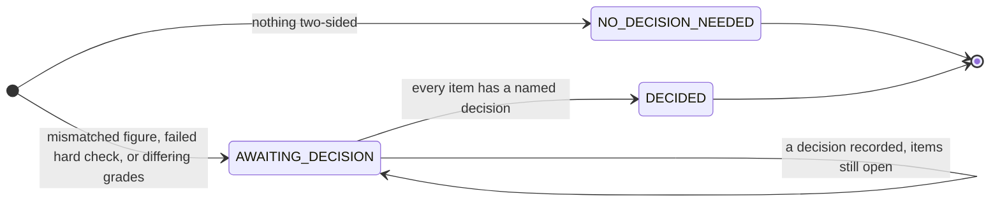

# Mycroft accountability layer

[](https://github.com/divij-pawar/mycroft-accountability/actions/workflows/ci.yml)
[](https://divij-pawar.github.io/mycroft-accountability/)


**LLM agents fail quietly: a malformed answer, an invented figure, two agents that disagree and
nobody notices.** This system wraps agents in a strict output contract that retries or halts, runs
two agents on the same SEC filings and compares their figures one by one, and stops at a human
decision gate when they disagree, keeping an append-only record of every attempt and decision.

<!-- Demo GIF goes here: record the review app (New compare -> both agents live -> the figure
     matrix -> the decision gate) and embed it with . -->

> [!IMPORTANT]
> **Research prototype. Localhost only.** An auditor token now needs an admin key and the write
> routes need a token, but runs are still stored at full detail and redacted only when read, and the
> reviewer's name is typed, not authenticated
> ([Honest Ledger: `audit-criticals`](https://divij-pawar.github.io/mycroft-accountability/ledger.html#audit-criticals)).
> Don't expose it to a network.

> [!NOTE]
> **What it doesn't claim.** It detects *numeric* disagreement between two agents' conclusions, not
> reasoning errors. It doesn't decide which agent is right; a person does. A grade is always a
> model's judgment unless a human set it. The reviewer's name at the gate is typed, not
> authenticated.

**Contents:** [Architecture](#architecture) · [Walkthroughs](#walkthroughs) ·
[Quickstart](#quickstart) · [Resilience and edge cases](#resilience-and-edge-cases) ·
[Project layout](#project-layout) · [Documentation](#documentation) · [Status](#status)

## Architecture

The code is split into layers with a one-way dependency rule: a layer may import only from the
layers beneath it. [`tests/test_layering.py`](tests/test_layering.py) reads every import with `ast`
and fails naming the file and line of any import the rule forbids.



### A ticker compare, end to end



### The two state machines that stop things

Every agent attempt goes through the ADR-07 loop. Every compare run goes through the gate.





Runs stored before the gate existed are `NOT_GATED` and are never gated retroactively.

## Walkthroughs

Every output below is from a recorded real run, kept as a test fixture in
[`web/frontend/tests/fixtures/`](web/frontend/tests/fixtures/). Nothing is invented for the README.

### 1. Two agents disagree, and the gate stops the run

Run `ec1a3b44` (2026-09-25), a subject compare: "In what year was the first Pokemon game released
in North America?" Agent A ran on `llama3.2`, agent B on `qwen2.5:7b`, both with web search.

| | Agent A | Agent B |
|---|---|---|
| Conclusion | "…in North America was in 1998, with the release of Pokémon Red and Blue for Game Boy." | "…was released in North America in 1996 [SOURCE: GameFAQs, …]." |
| Figure | `1998` | `1996` |

The comparison gives one row, `release_year: MISMATCH`, the only two-sided conflict, so the gate
opens and the run is `AWAITING_DECISION`. **An investor-scope read of the same run** keeps the
status but withholds both values and both conclusions until someone decides:

```json
{ "metric": "release_year", "status": "MISMATCH", "raw_a": null, "raw_b": null, "withheld": true }
```

with the note *"Pending human review: this run has an open decision (a disputed figure, a failed
check or the grade)."* A reviewer decides through the API (or the review app):

```bash
AUDITOR_TOKEN=$(curl -s -X POST localhost:8000/api/auth/token -H "content-type: application/json" \
  -H "x-admin-key: $ACCOUNTABILITY_ADMIN_KEY" -d '{"scope": "auditor"}' | python -c 'import sys,json; print(json.load(sys.stdin)["access_token"])')
curl -X POST localhost:8000/api/runs/<run_id>/decisions \
  -H "authorization: Bearer $AUDITOR_TOKEN" -H "content-type: application/json" \
  -d '{"decision": "accept_a", "decided_by": "A. Reviewer", "cited_items": ["release_year"],
       "rationale": "NA release was September 1998; 1996 is the Japanese release."}'
```

A decision that can't be checked is **refused, never repaired**. With a short rationale the
server answers 422: *"Give your reasoning in at least 20 characters."* Decisions are appended to a
table SQLite itself refuses to update or delete.

> [!NOTE]
> This run is still awaiting a real reviewer. The decision above illustrates the request shape;
> no AI records a gate decision, by design.

### 2. Every figure checked against the filing

Run `20c538e4` (2026-09-25), `AAPL`, both agents on `llama3.2`, the financial lens against the
earnings lens. The two agents agree where they overlap:

| Metric | Agent A | Agent B | Status |
|---|---|---|---|
| Diluted EPS | `$2.02` | `$2.02` | `MATCH` |
| Net income | `$29.79 billion` | `$29.788 billion` | `MATCH` (0.01% apart) |
| Revenue | `$109.4 billion` | — | `ONE_SIDED` (only A's lens carries it) |
| Revenue change | `16%` | — | `UNCORROBORATED` |

Agreement isn't proof, so the accounting checks ask separately whether each agent quoted its
source correctly and whether the filing itself adds up:

```text
matches_source       hard       pass  Agent A     cited $29.79 billion; given $29.79B (3 months ending 2026-06-27, 10-Q)
matches_source       hard       pass  Agent B     cited $29.788 billion; given $29.79B (3 months ending 2026-06-27, 10-Q)
balance_sheet_filed  hard       pass  The filing  assets $383.3B vs liabilities and equity $383.3B (as of 2026-06-27)
eps_basic_ge_diluted hard       pass  The filing  basic $2.03 vs diluted $2.02 (2026-03-29 to 2026-06-27)
net_le_operating     heuristic  pass  The filing  net income $29.79B vs operating income $35.7B (2026-03-29 to 2026-06-27)
```

A failed **hard** check on an agent's own figures opens the gate; heuristics and checks on the
filing only inform. In the review app, each figure has a **Source** button that shows it inside the
10-Q itself, located through its inline-XBRL tag.

### 3. Two grades, one explanation

Run `8ecb0922` (2026-09-27), `AAPL`. After each answer passes, a separate model call reads it for
a structured assessment in a closed vocabulary (`AAA`…`CCC`, `buy`/`hold`/`sell`). Values outside
it are refused, never coerced.

| | Grade | Direction | Stated assumptions |
|---|---|---|---|
| Agent A | `AAA` | `buy` | revenue growth 16%, margins stable |
| Agent B | `A` | `buy` | margins expanding |

The synthesis calls no model. It classifies the disagreement (`data`, `assumption` or
`weighting`) and counts the evidence behind each grade, without scoring it: *"Same figures,
different assumptions: agent A assumes stable margins, agent B assumes expanding margins. Decide
which assumption the evidence supports."* There is no consensus ("The agents' grades or directions
differ"), so a `grade` item opens at the gate, and only a grade a human sets is ever shown to
investors.

> [!WARNING]
> This run used the first extraction prompt (`assess-extract-v1`), which the record later found
> reported past growth as a forward assumption, so its `assumption` class is unreliable. The prompt
> was revised (`assess-extract-v2`), and the synthesis still rests on few live runs
> ([`synthesis-thin-and-lexical`](https://divij-pawar.github.io/mycroft-accountability/ledger.html#synthesis-thin-and-lexical)).

### 4. The review, exported

Any compare run exports as an audit record (JSON) or a Markdown review, built after scope
redaction, so an investor's export carries only what an investor may see:

```bash
curl localhost:8000/api/runs/<run_id>/export.md -H "authorization: Bearer $INVESTOR_TOKEN" -o review.md
```

## Quickstart

### Sandbox: no model, no keys, no cost

The test suites are network-free and model-free by design. They exercise the loop, the comparison,
the checks, the gate and redaction with scripted agents and the recorded runs above:

```bash
git clone https://github.com/divij-pawar/mycroft-accountability.git && cd mycroft-accountability
python -m venv env && source env/bin/activate      # Windows (Git Bash): source env/Scripts/activate
pip install -r requirements.txt
python -m unittest discover -s tests -t .
```

```bash
python scripts/build_docs.py                        # rebuild the reference site; fails on any undocumented file
cd web/frontend && npm ci && npm run verify         # type-check, Vitest on recorded runs, build
```

There is deliberately no mock mode in the running app: a scripted answer would look like evidence
(design decision [D-17](https://divij-pawar.github.io/mycroft-accountability/decisions.html#d-17)).

### Live: local model and real filings

```bash
ollama pull llama3.2
cp .env.example .env            # set SEC_USER_AGENT; TAVILY_API_KEY enables web search
scripts/start-server.sh         # builds the review app if needed, then serves on :8000
```

Open <http://localhost:8000/>, choose **New compare**, enter `AAPL`, and watch both agents work.
Every setting and environment variable is on the
[configuration page](https://divij-pawar.github.io/mycroft-accountability/config.html).

### Docker

```bash
docker build -t mycroft-accountability .
docker run --rm -p 127.0.0.1:8000:8000 --env-file .env mycroft-accountability
```

The image holds the server and the built review app; the model stays outside (Ollama on the host,
through `host.docker.internal`). Publish the port on `127.0.0.1` only.

## Use your own agent: Claude Code, Codex or Cursor

No API key needed: the agent runs in your own session, with your own login, and the
verification layer connects to it as an MCP server. The layer never calls the model; it checks,
records and gates what your agent submits, through exactly the same contract, retry, comparison,
checks and gate as a run it drives itself.

```bash
scripts/start-server.sh                                              # the server, with /mcp
claude mcp add --transport http mycroft http://localhost:8000/mcp \
  --header "Authorization: Bearer $ACCOUNTABILITY_ADMIN_KEY"          # Claude Code
```

`/mcp` needs the admin key as a Bearer token. `scripts/start-server.sh` saves one in `.env` the first
time it runs (`ACCOUNTABILITY_ADMIN_KEY`); load it into your shell before the command above. Codex and
Cursor take the same URL and header in their MCP settings (not yet tried with either). Then ask your agent something like
*"Use the mycroft tools to run a compare on AAPL"*:

1. `start_compare(ticker="AAPL")` creates the run, and your session is agent A. Agent B is the
   local model (`partner="ollama"`, the default) or a second session (`partner="session"`, which
   another agent joins with `join_compare`).
2. Your agent reads the instructions and the filing figures it's given, researches with the
   layer's `search` tool (recorded) or its own web search, and calls `submit` with its reply.
3. The server checks the format. A broken reply comes back as a retry with the reason; a second
   one halts that side. Then it asks for the grade JSON, and the run is compared, checked and
   gated as usual.
4. Watch it live in the review app under **Live runs** (`#/live`), or at the `watch` link every
   tool reply carries.

The session's name is what the MCP client reports about itself: recorded as given, not
verified. Keep the server on localhost.

## Resilience and edge cases

What goes wrong with agents, what the system does about it, and the evidence it works. "Tested"
means covered by the suites; "observed" means seen on a real model, with the record's numbers.

| Failure | What happens | Evidence |
|---|---|---|
| **Malformed output** (missing blocks, text outside them) | One retry with a corrective directive, then halt; every attempt kept ([ADR-07](https://divij-pawar.github.io/mycroft-accountability/f-validation-loop.html)) | Observed: 13 retries in 48 real-model agent runs, 4 recovered, 9 halted (2026-09-22 to 2026-09-24) |
| **The model parrots its instructions** | A conclusion copying 8+ consecutive words of the directive, or an empty one, is a structural failure | Observed: 7 of 10 stored v1.5.0 conclusions had echoed it before the check existed |
| **The model server stalls** | `MODEL_TIMEOUT_S` (default 120 s with nothing received) abandons the call; the run is recorded as halted with the reason | Tested against a stub server; Ollama hung 4 times in compares before it existed |
| **An agent loops on tool calls** | At most 4 tool round trips per call | Tested with a fake model that never stops: exactly 4 round trips, each traced, the last reply returned (`tests/test_adapter_tool_limits.py`); not observed on a real model |
| **Placeholder tool arguments** (`"None"`, `"N/A"`) | One retry with only the query; a second failure is shown to the model as a tool error, never a fake result | Observed live, then tested |
| **No search key** | The call runs without tools, and the server warns when a message contains a URL it can't check | Tested with the key unset: no tool is bound, and the server warns about a URL it can't check (`tests/test_adapter_tool_limits.py`) |
| **Invented or misquoted figures** | Cross-agent `MISMATCH` gates; `UNCORROBORATED` flags one-sided figures; each figure is checked against the filing value the agent was given; citations are fetched and checked | Tested; a fabricated AAPL debt-to-equity figure is the corpus's confirmed true positive |
| **Two agents at once** | Thread-safe step trace; unique, gap-free sequence numbers | Tested; observed overlapping model calls of 39.4 s and 16.9 s |
| **The browser closes mid-run** | The run keeps going and is stored anyway: "a closed browser tab must not be able to delete" the record | In the code; not covered by a test |
| **Disputed values leaking to investors** | Redaction covers the record, the live stream and search results in the trace | A leak via search results was found and fixed on 2026-09-26, then verified on a restarted server |
| **Rate limits** | Not handled beyond what the client libraries do | Open |

## Project layout

```text
core/          contracts (AgentAdapter, ModelCall, JsonFetcher), versioned directives, parser, schemas, assessment vocabulary
adapters/      the LangChain adapter (Ollama or Gemini, Tavily tool loop, stall timeout) and the provider registry
pipeline/      the retry-then-halt validation loop; LangFuse tracing
datasources/   SEC EDGAR companyfacts; inline-XBRL filing excerpts
financial_agent/  the user-facing financial agent (in progress, see its PLAN.md): Alpha Vantage prices, indicators, frozen bundles
producers/     concept lenses: financial, earnings, bull, bear; the two pairings
validation/    figure comparison, accounting checks, decision gate and redaction, synthesis, audit export
web/           FastAPI server, SQLite store, scope tokens, step trace, Honest Ledger; web/frontend/ is the React review app
tests/         the network-free, model-free suite, including the layering and docs-coverage tests
scripts/       start-server.sh, build_docs.py, live-run scripts
docs/          the reference site (docs/) and design documents
archive/       replaced files, moved rather than deleted
logs/          RUN_LOG.md: every change, live run and correction, append-only
.github/       CI and GitHub Pages workflows
```

## Documentation

**[The reference site](https://divij-pawar.github.io/mycroft-accountability/)** documents every
file, feature, layer and design decision. It covers a run end to end, the HTTP API,
configuration, record shapes, 49 decision records, the Honest Ledger, and a list of places where
older documents no longer match the code. The file inventories, routes, environment variables and
the ledger are generated from the code on every build, and
[`tests/test_docs_coverage.py`](tests/test_docs_coverage.py) fails if any file has no entry or any
link breaks.

Offline, open `docs/index.html` directly (it's static HTML), or rebuild it with
`python scripts/build_docs.py`.

## Status

- **Built and tested:** everything above. The CI badge reflects the current suites.
- **Observed on real models:** the compare runs cited above, on local `llama3.2` and `qwen2.5:7b`.
  Gemini's key is suspended by Google (HTTP 403, rechecked 2026-10-26), so nothing has been observed
  on it.
- **The financial agent** (`financial_agent/`, the Analysis page): built and tested, and each figure a
  signal cites is checked against the tool result it cites (Tier 1, no model). Measured live on one
  local model only. `llama3.2`, 10 runs on AAPL: 8 first replies passed the reply format and **none of
  the 5 figures cited was grounded**, because the model made one data call and then cited calls it
  never made ([`small-model-invents-tool-use`](https://divij-pawar.github.io/mycroft-accountability/ledger.html#small-model-invents-tool-use)).
  No other model has been measured. It does not claim that any signal is right.
- **Known issues** are listed, with sources, in the
  [Honest Ledger](https://divij-pawar.github.io/mycroft-accountability/ledger.html), and served live
  at `GET /api/self-report`.
- **Two repositories.** This repo is kept in sync with `verification-layer/` in
  [`nikbearbrown/mycroft`](https://github.com/nikbearbrown/mycroft) (branch
  `feature/accountability-layer`) using `git subtree`; see [`CLAUDE.md`](CLAUDE.md).
- **Change history:** [`logs/RUN_LOG.md`](logs/RUN_LOG.md), append-only; corrections are new entries.
